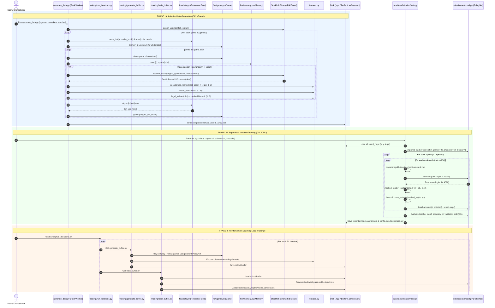
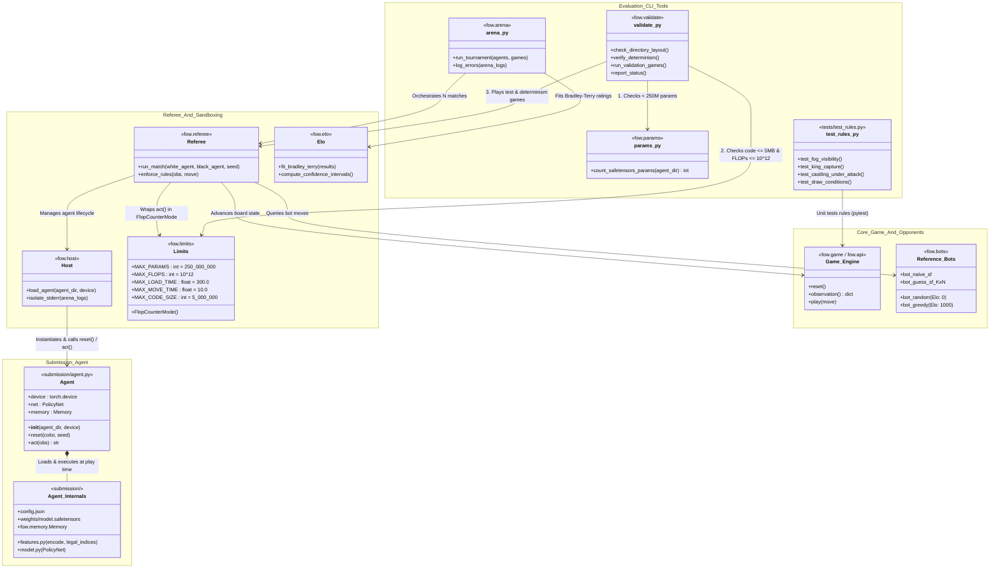
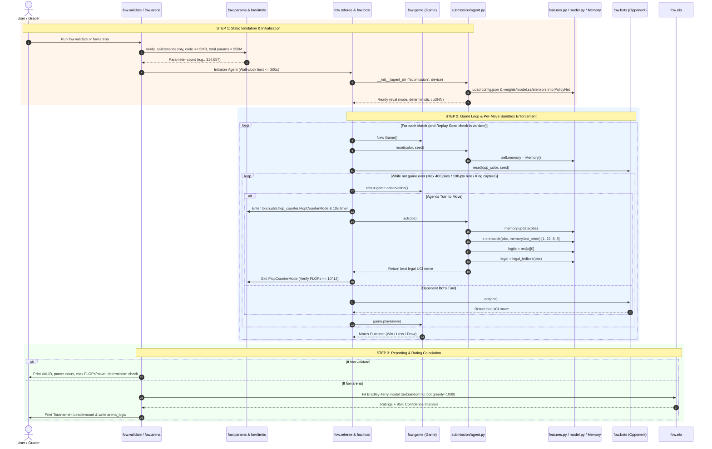

I have restructured and formatted your system design into a clean **Markdown (`.md`)** document.

Markdown is the native format for LLMs like Gemini—it preserves structural hierarchy (`#`, `##`), tabular relationships, and code/Mermaid diagram blocks with minimal token overhead. You can copy the block below directly into a prompt, or save it as `SYSTEM_DESIGN.md` (or `.txt`) to upload as a context attachment.

I also integrated the new **Reinforcement Learning (`training/`) pipeline** (`run_iterations.py`, `generate_buffer.py`, and `train_buffer.py`) into the workflow table, architectural takeaways, and Mermaid diagrams.

---

```markdown
# System Architecture & Design: Fog-of-War (`fow`) Chess Project

## 1. Project Overview
This repository implements a Fog-of-War (FoW) chess environment, training pipelines (Imitation Learning and Reinforcement Learning), and a sandboxed evaluation/arena suite. All workflows share the core `fow/` game package and the `submission/` (or `agents/baseline/`) feature and model definitions.

---

## 2. High-Level Workflows & File Mapping

The repository splits into four distinct workflows (Imitation Data Gen, Imitation Training, RL Loop, and Evaluation):

| Workflow Stage | Entry Point / Trigger | Core Files Involved | Artifacts Produced / Consumed |
| :--- | :--- | :--- | :--- |
| **1A. Imitation Data Generation** *(Training System — Part A)* | `baselines/imitation/generate_data.py` *(or `scripts/sol/generate_data.sbatch`)* | • `fow/game.py` (rules engine)<br>• `fow/bots.py` (reference bots + Stockfish path)<br>• `fow/memory.py` (last-seen piece tracker)<br>• `stockfish/` (UCI teacher binary)<br>• `features.py` (encodes obs + moves) | **Outputs:** `data/imitation/shard_*.npz` containing:<br>• `x`: `uint8 [N, 22, 8, 8]`<br>• `y`: `int16 [N]`<br>• `legal`: `uint8 [N, 512]` |
| **1B. Imitation Model Training** *(Training System — Part B)* | `baselines/imitation/train.py` *(or `scripts/sol/train.sbatch`)* | • `data/imitation/*.npz` (training shards)<br>• `submission/model.py` (dynamically imported `PolicyNet`) | **Outputs:** Writes `submission/config.json` and `submission/weights/model.safetensors`. |
| **2. Reinforcement Learning Pipeline** *(Iterative RL System)* | `training/run_iterations.py` *(RL loop orchestrator)* | • `training/run_iterations.py` (calls buffer gen & training)<br>• `training/generate_buffer.py` (self-play / rollout buffer generation)<br>• `training/train_buffer.py` (trains network on generated buffer)<br>• `fow/game.py`, `fow/memory.py`, `submission/model.py`, `submission/features.py` | **Consumes & Outputs:** Iteratively generates replay buffers and updates `submission/weights/model.safetensors` across RL iterations. |
| **3. Agent Testing, Validation & Arena** *(Testing & Evaluation System)* | • `python -m fow.validate submission`<br>• `python -m fow.arena ...`<br>• `python -m pytest tests` | • `fow/validate.py`, `fow/params.py`, `fow/limits.py`<br>• `fow/arena.py`, `fow/elo.py`, `fow/referee.py`, `fow/host.py`<br>• `submission/agent.py`, `model.py`, `features.py`, `config.json`, `weights/model.safetensors` | **Outputs:** Validation status (`VALID`), parameter counts, per-move FLOPs (`FlopCounterMode`), Elo ratings (`elo.py`), and error logs (`arena_logs/`). |

> **Orchestration Note:** 
> * `reproduce.sh` is the master baseline orchestrator script that runs **Workflow 1A -> Workflow 1B -> Workflow 3 (`fow.validate`)** sequentially.
> * `training/run_iterations.py` is the master RL orchestrator that alternates between `training/generate_buffer.py` and `training/train_buffer.py` in a continuous loop.

---

## 3. System 1: Training Systems (Imitation & RL) UML Diagrams

### A. Class & Component Diagram (Training Pipelines)
This diagram maps the relationships between the master scripts, the baseline imitation pipeline, the `training/` RL pipeline, the core `fow` engine, and shared agent modules.

```mermaid
classDiagram
    direction TB

    namespace Master_Scripts {
        class reproduce_sh {
            <<script>>
            +$STOCKFISH : str
            +$WORKERS : int
            +$DEVICE : str
            +run_pipeline()
        }
        class Sol_Batch_Scripts {
            <<slurm>>
            +setup_env.sh
            +generate_data.sbatch
            +train.sbatch
        }
    }

    namespace Imitation_Data_Generation {
        class generate_data_py {
            <<baselines/imitation/>>
            +MATCHUPS : list~tuple~
            +main()
            +worker(args) int
            +teacher_move(engine, game, nodes) str
        }
        class StockfishEngine {
            <<external binary>>
            +popen_uci(stockfish_path)
            +play(board, Limit) Move
        }
        class NPZ_Shards {
            <<dataset>>
            +x : uint8 [N, 22, 8, 8]
            +y : int16 [N]
            +legal : uint8 [N, 512]
        }
    }

    namespace Imitation_Training {
        class train_py {
            <<baselines/imitation/>>
            +load_model_class(agent_dir) PolicyNet
            +batch(idx) tuple
            +masked_logits(xb, mb) Tensor
            +main()
        }
    }

    namespace RL_Training_Pipeline {
        class run_iterations_py {
            <<training/run_iterations.py>>
            +run_rl_loop()
        }
        class generate_buffer_py {
            <<training/generate_buffer.py>>
            +generate_rollouts()
        }
        class train_buffer_py {
            <<training/train_buffer.py>>
            +train_on_buffer()
        }
        class RL_Replay_Buffer {
            <<training/ buffer>>
            +states / actions / rewards
        }
    }

    namespace FOW_Core_Engine {
        class Game {
            <<fow.game>>
            +board : chess.Board
            +over : bool
            +observation() dict
            +legal_uci() list~str~
            +play(uci_move)
        }
        class Bots {
            <<fow.bots>>
            +stockfish_path() str
            +make_bot(spec) Bot
            +reset(color, seed)
            +act(obs) str
        }
        class Memory {
            <<fow.memory>>
            +last_seen : dict
            +update(obs)
        }
    }

    namespace Agent_Shared_Modules {
        class features_py {
            <<submission / baseline>>
            +ORDER : str = "PNBRQK"
            +N_PLANES : int = 22
            +N_MOVES : int = 4096
            +sq_index(name) int
            +orient(sq, color) int
            +encode(obs, last_seen) ndarray
            +move_index(uci, color) int
            +legal_indices(obs) dict
        }
        class PolicyNet {
            <<submission/model.py>>
            +stem : nn.Sequential
            +blocks : nn.Sequential~Block~
            +head : nn.Conv2d
            +forward(x) Tensor
        }
        class Block {
            <<submission/model.py>>
            +c1 : nn.Conv2d
            +b1 : nn.BatchNorm2d
            +c2 : nn.Conv2d
            +b2 : nn.BatchNorm2d
            +forward(x) Tensor
        }
        class Saved_Artifacts {
            <<submission/>>
            +config.json
            +weights/model.safetensors
        }
    }

    reproduce_sh --> generate_data_py : 1. Executes
    reproduce_sh --> train_py : 2. Executes
    Sol_Batch_Scripts ..> generate_data_py : Slurm CPU Job
    Sol_Batch_Scripts ..> train_py : Slurm GPU Job

    generate_data_py --> Game : Simulates FoW games
    generate_data_py --> Bots : Instantiates MATCHUPS
    generate_data_py --> Memory : Tracks hidden enemy pieces
    generate_data_py --> StockfishEngine : Queries full-board teacher (5000 nodes)
    generate_data_py --> features_py : Encodes obs & legal masks
    generate_data_py --> NPZ_Shards : Writes shard_{seed}_{wid}.npz

    train_py --> NPZ_Shards : Reads & concatenates shards
    train_py --> PolicyNet : Dynamically loads via importlib
    PolicyNet *-- Block : Contains N residual blocks
    train_py --> Saved_Artifacts : Exports weights & config

    run_iterations_py --> generate_buffer_py : 1. Calls per iteration
    run_iterations_py --> train_buffer_py : 2. Calls per iteration
    generate_buffer_py --> Game : Self-play / rollouts
    generate_buffer_py --> features_py : Encodes states
    generate_buffer_py --> RL_Replay_Buffer : Writes trajectories
    train_buffer_py --> RL_Replay_Buffer : Reads trajectories
    train_buffer_py --> PolicyNet : Updates network
    train_buffer_py --> Saved_Artifacts : Exports updated weights
```



### B. Sequence Diagram (Imitation Data Generation, Supervised Training, & RL Loop)
This sequence diagram traces runtime execution across the imitation pipeline (`generate_data.py` -> `train.py`) and the iterative RL loop (`training/run_iterations.py`).



---

## 4. System 2: Testing, Validation & Arena Evaluation UML Diagrams

### A. Class & Component Diagram (Testing & Evaluation System)
This diagram illustrates how the submitted agent (`submission/`) interacts with the `fow` evaluation tools (`validate.py`, `arena.py`, `referee.py`, `limits.py`, `params.py`, `elo.py`, and `tests/test_rules.py`).



### B. Sequence Diagram (Validation & Arena Match Flow)
This sequence diagram shows what happens under the hood when running `python -m fow.validate submission` or `python -m fow.arena submission bot:greedy ...`.



---

## 5. Key Architectural Rules & Gotchas

### 1. Synchronization Between `agents/baseline/`, `submission/`, and `training/`
* **`agents/baseline/`** is the read-only reference snapshot of the shipped baseline.
* **`submission/`** starts as an exact clone of `agents/baseline/`. When modifying `features.py` (e.g., adding $N=7$ history frames) or `model.py` (e.g., swapping in SE-ResNet, Maia-2 blocks, or a Belief head), all training and inference entry points—`baselines/imitation/generate_data.py`, `baselines/imitation/train.py`, `training/generate_buffer.py`, `training/train_buffer.py`, and `submission/agent.py`—**must** import and agree on the exact same `features.py` and `model.py` definitions.
* **Critical Path Gotcha:** By default, line 23 of `baselines/imitation/generate_data.py` sets `sys.path.insert(0, os.path.join(ROOT, "agents", "baseline"))`. When modifying `submission/features.py`, update `generate_data.py` (and ensure `training/generate_buffer.py` is configured similarly) to import `features` from `submission/` so generated `.npz` shards and RL buffers match the new feature plane dimensions.

### 2. Strict Separation of Training-Time vs. Play-Time Dependencies
* **Training Systems (`baselines/imitation/*` and `training/*`):**
  * Can freely use `stockfish/`, `fow/bots.py`, multiprocessing workers, replay buffers, and external pretrained checkpoints.
  * `training/run_iterations.py` coordinates iterative RL by invoking `training/generate_buffer.py` and `training/train_buffer.py`.
* **Testing / Play-Time System (`submission/agent.py`):**
  * Strictly sandboxed. Can **only** access files inside `submission/` (`config.json`, `features.py`, `model.py`, `weights/*.safetensors`) and permitted `fow` utilities like `fow.memory.Memory`.
  * **Hard Resource Limits:**
    * Max Parameters: `< 250,000,000` (250M) stored strictly in `.safetensors`
    * Max Code Size: `<= 5 MB`
    * Max Load Time: `<= 300.0s`
    * Max Move Time: `<= 10.0s` per move
    * Max Compute per Move: `<= 10^12` FLOPs
  * **Synchronous PyTorch Execution:** All neural network operations inside `act()` must execute synchronously on the main thread in PyTorch so `fow/limits.py` (`FlopCounterMode`) can accurately track FLOPs.

```